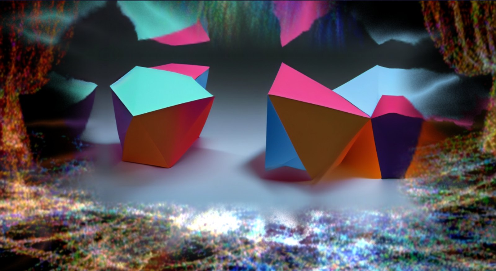

<div align="center">

# dream_gen

**A dream that never stops.**

Stable Diffusion 1.5 in an endless loop. Every frame grows out of the one before,<br>
and the words steering the loop come from ten trillion possible prompts, so dream_gen never repeats itself.

[**Watch dreams live**](https://aetherawi.red/dreams) · [Read the chronicle](https://aetherawi.red/dreams/chronicle) · [The site](https://github.com/LuxiaSL/aethera) · [The vocabulary](https://github.com/LuxiaSL/apeiron)



</div>

## How it works

Feed an image model its own output and it collapses. The picture drifts toward the
model's favourite mush, and the colours slide into magenta. dream_gen is built to
keep wandering instead.

```
   prompt = a template with 3–7 slots, each filled from one of 12 visual axes
                                    │
   anchor ──img2img 0.18──► keyframe ──► keyframe ──► …     about 1 keyframe a second,
     ▲                                                       20 interpolated frames between each,
     │                                                       streamed at 30 fps
     │  a word mutates every few seconds:
     └─ re-dream the anchor at 0.70 with the new words ──► the new anchor

        about every 45 s   a memory is recalled and merged into the present
        about every 15 min a new era begins from a fresh txt2img
```

- **dream_gen walks from anchor to anchor.** Most keyframes are small img2img steps from the
  one before. When a word changes, dream_gen goes back to the last anchor and re-dreams
  it at high denoise with the new words. That keyframe becomes the new anchor, and the
  small steps since the last one are dropped from the lineage. They never pile up for
  long, so the picture never dissolves.
- **Words mutate one at a time.** Each mutation trades one word for a neighbour that is
  near, but not too near. Nearness is measured in two embedding spaces: CLIP for the
  look of a word, and T5 for its meaning. A word can't return while it is among the last six held in its slot.
- **Memories are re-dreamed, not crossfaded.** dream_gen keeps a small cache of frames
  that were truly different, in structure, colour and latent distance. To recall one,
  dream_gen redraws the present with the memory as an
  [IP-Adapter](https://github.com/tencent-ailab/IP-Adapter) image prompt, after
  shifting the present's palette toward it. A crossfade made a ghostly double
  exposure. This makes one picture that remembers.
- **Eras.** Every 1,000 keyframes a new template and a fresh txt2img frame open a new
  era, merged in the same way so the last era leaves a trace. Each era has its own
  noise seed and its own memories.
- **Colour stays honest.** Each new anchor is recoloured toward a fresh render of its
  own prompt, which keeps the loop from drifting into magenta.

Between keyframes, frames are spherical interpolations in the VAE's latent space. They
are encoded to H.264 on the GPU machine and streamed to the site, which passes them on
to every viewer. dream_gen saves its state as it runs, so a restart picks up where the last run
left off.

## Ten trillion prompts

14 templates, 12 visual axes and 741 words make 1.06 × 10¹³ distinct prompts. More than
400,000 keyframes in, dream_gen has used a few billionths of them.

The words were chosen, not brainstormed, in [apeiron](https://github.com/LuxiaSL/apeiron):

1. **Generate.** Four model families (Claude, Kimi K2, DeepSeek and GPT) take turns
   proposing words for each axis. Each is told to avoid everything already said. That
   yields about 3,700 candidates.
2. **Select.** Every candidate is embedded twice: in OpenCLIP ViT-bigG for its look,
   and in T5-XXL for its meaning. A word has to sit closest to its own axis in both
   spaces. Near-duplicates in either space are cut, and farthest-point sampling keeps
   the words that are far apart in either.
3. **Fill the gaps.** Empty regions of the space are decoded back into words through
   T5, to find what is missing.
4. **Curate** by hand, down to 741.

The axes were checked against each other the same way, so no two say the same thing.
The templates range from three-word haiku (`essence`) to seven-slot collisions of two
materials.

## The chronicle

dream_gen records its own history. Each keyframe sends its prompt, its events and a small
thumbnail to the site. The site groups keyframes into eras and scenes. It paints the whole
history as one strip, a slit-scan in which every era is its own band of colour and
structure. The detail is kept for two weeks. The strip, and one picture from every
scene, are kept for good.

[**aetherawi.red/dreams/chronicle**](https://aetherawi.red/dreams/chronicle)

## Run your own

dream_gen is cheap to run: about a dollar an hour on a GPU rented from RunPod.
You need Linux, Python 3.11 or 3.12, an NVIDIA GPU and [uv](https://docs.astral.sh/uv/).
SD 1.5 and the weights for IP-Adapter download from Hugging Face on first run.
To keep them somewhere other than the default cache, set `DREAMGEN_HF_CACHE`.

```bash
git clone https://github.com/LuxiaSL/dream_gen && cd dream_gen
uv sync
uv run python backend/cloud/heimdall_entry.py \
  --config backend/config.b200.yaml \
  --vps-url wss://your-site/ws/gpu --auth-token "$DREAM_GEN_AUTH_TOKEN"
```

The frames go to an [aethera](https://github.com/LuxiaSL/aethera) server, which serves
them to browsers at `/dreams`. The config runs the UNet and the VAE on two GPUs. To use
one GPU, give `system.gpu_devices` the same id twice. Every setting is commented in
[`backend/config.b200.yaml`](backend/config.b200.yaml).

## Further reading

| | |
|---|---|
| [SPEC-anchor.md](SPEC-anchor.md) | anchor walking: why the loop stopped dissolving |
| [SPEC-chronicle.md](SPEC-chronicle.md) | how dream_gen records its own history |
| [SPEC-resume.md](SPEC-resume.md) | saving and resuming where dream_gen left off |
| [SPEC-multi-gpu-pipeline.md](SPEC-multi-gpu-pipeline.md) | splitting the work across two GPUs |
| [SPEC-webcodecs-streaming.md](SPEC-webcodecs-streaming.md) | H.264 from the GPU to the browser |

dream_gen started in November 2025 as a desktop wallpaper, rendered through ComfyUI on a
home PC.

## Credits

Made by [luxia](https://x.com/slLuxia).

MIT licensed. See [LICENSE](LICENSE).
